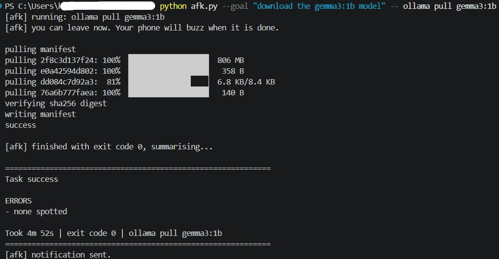
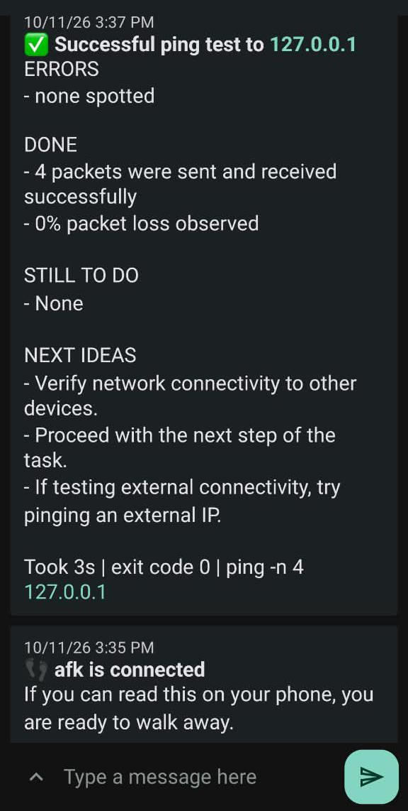
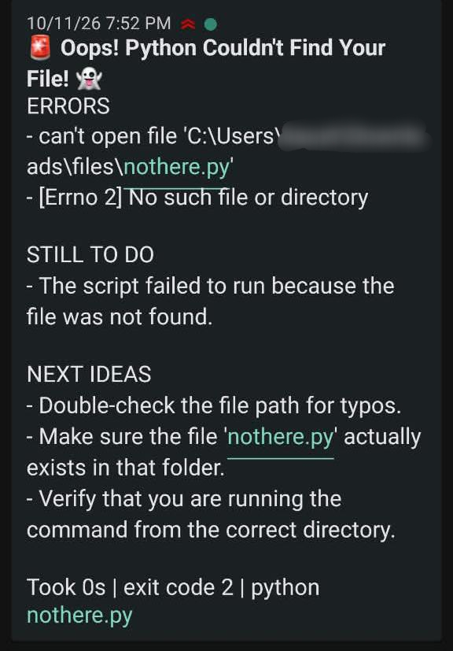
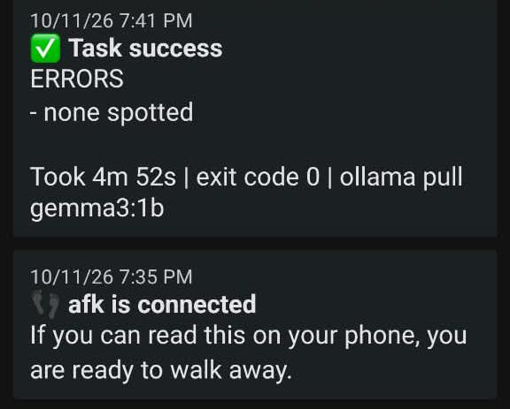

# afk

Run a long command, go do something else, get a message on your phone when it's done.

I wrote this because I kept sitting in front of progress bars. A model download, a build, a test run. I couldn't speed any of it up, but I couldn't really leave either, because I wanted to know the second it finished or broke. So `afk` wraps the command. You start it and leave. When the command ends, a small Gemma model running on your own machine reads the log and your phone gets a short report.



That's a model download with a goal attached. I started it and walked away.

Every report has the same four parts: errors, done, still to do, next ideas. This one is from a boring `ping` test, but you can see all four:



## Setup (Windows)

1. Python 3.9 or newer. There is nothing to `pip install`, it only uses the standard library.
2. [Ollama](https://ollama.com), then `ollama pull gemma4:e2b`. That one fit on my 4 GB laptop GPU. If you use another model, change `"model"` in `afk.json`.
3. The [ntfy](https://ntfy.sh) app on your phone.
4. In this folder, run `python afk.py --init`. It prints a topic name. Subscribe to it in the ntfy app.
5. `python afk.py --ping` should buzz your phone.

## Using it

```
python afk.py -- npm run build
python afk.py --goal "train for 3 epochs" -- python train.py
python afk.py --style funny -- python nothere.py
python afk.py -- "npm run build && npm test"
python afk.py --dry-run -- echo hi
```

`--goal` tells the model what you wanted, which is the only way it can say what's still left. Without it, it writes "unclear from the log" instead of guessing.

`--style` changes the tone. There are four presets in `afk.json` (plain, coach, funny, calm), and you can pass your own words, like `--style "grumpy sysadmin"`. Here is the same failing script with `funny`. The headline gets silly but the error underneath stays accurate:



## What I actually ran

- `ping` to localhost: took 3 seconds, report was right.
- A Python script that doesn't exist: the report quoted the real error. My first runs put "Command execution finished (failed)" under DONE, which tells you nothing. Later runs were cleaner.
- `ollama pull gemma3:1b`, about 5 minutes. I left the laptop, and the phone buzzed at 7:41 PM:



It said "none spotted" and not much else. That's the next section.

## Where it falls short

- It is only as good as the log. Download progress bars barely show up in the output, so the model had almost nothing to read.
- Small models pad. Sometimes a list gets a line that says nothing.
- If the laptop is offline when the command ends, the notification fails. The report is still saved in `afk_logs/`, but it doesn't retry.
- A program that stops to ask y/n will just sit there. Use its `-y` flag.
- Interactive chats with a coding agent never exit, so there is nothing to notify about. One-shot commands work.
- I only tested on Windows, Python 3.14, with `gemma4:e2b`. It's plain standard-library Python, so Mac and Linux should work, but I haven't tried.

## Privacy

The raw log stays on your machine and Gemma runs locally. The short summary does go through the ntfy server (ntfy.sh unless you change `ntfy_server`). Obvious secrets like `api_key=...` get hidden first, but that is best-effort. If your logs are sensitive, self-host ntfy. On ntfy.sh the topic name is the only thing protecting your notifications, so don't post it anywhere.

## How it works

It runs your command and saves the output. At the end it sends the first lines, the lines that mention errors, and the last lines to Ollama's local API, and asks for JSON with the four sections. The exit code decides success or failure, not the model. The report goes to ntfy as a JSON POST.

## About

Built for DEV's Hacktoberfest Open-Source AI Challenge (Touch Grass). I used an AI assistant while writing the code, and I ran and tested every run above myself. Write-up: (link to my DEV post)

MIT license.
